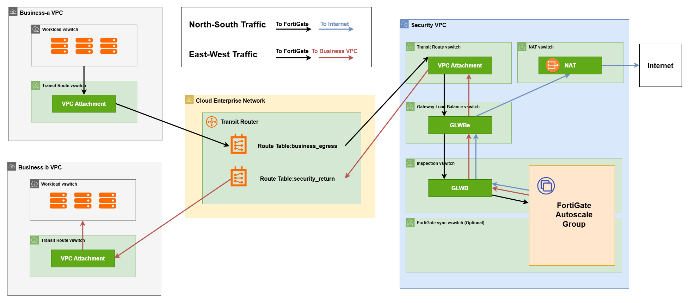

# Example: CEN Transit Router Centralized GWLB FortiGate Inspection

Use this example to deploy centralized inspection in one or more zones within one Alibaba Cloud region. The example connects existing business VPCs to a Security VPC through CEN Transit Router, it can manage the egress traffic (north-south traffic) and traffic between business VPCs (east-west traffic).

Note: Business VPCs are not created by this example. Please prepare business VPC in advance.

## Architecture

The example creates the following resources:



- A Security VPC with inspection, Transit Router, GWLBe, and NAT VSwitches and dedicated route tables in each zone defined in `security_vpc.zones`. A sync VSwitch is also created in each zone when `fgt_network_mode` is `"dual-port"`.
- One Enhanced CrossAZ NAT Gateway and one EIP for each zone defined in `security_vpc.zones`.
- One Gateway Load Balancer spanning the zones defined in `security_vpc.zones`, with one zone mapping and one Gateway Load Balancer endpoint per zone.
- A CEN instance when `cen_id` is empty, an Enterprise Edition Transit Router, and VPC attachments using each VPC's configured zones.
- One or more FortiGate Auto Scaling groups, each balancing instances across the shared inspection VSwitches and attached to the same GWLB server group.
- One lifecycle Function, Message Service topic, OSS bucket, and execution roles for each group when `function_compute.deploy_function = true`.

## Requirements

Before deployment, verify the following requirements:

- Terraform version is at least 1.9 and below 2.0.
- The Security VPC and all business VPCs use non-overlapping CIDR blocks.
- Each zone defined in `security_vpc.zones` must support GWLB, Enterprise Edition Transit Router VPC attachments, and Enhanced NAT Gateway.
- The selected FortiGate ECS instance type is available in each zone defined in `security_vpc.zones` and supports the configured number of ENIs.
- Object Storage Service, Auto Scaling, CloudMonitor, Function Compute, Message Service, Tablestore, Server Load Balancer, PrivateLink, Cloud Enterprise Network, Elastic IP, and NAT Gateway are activated.

## How To Deploy

```bash
cd examples/cen_tr_gwlb_fgt
terraform init
cp terraform.tfvars.one_asg.template terraform.tfvars
```

Two templates are available:

- `terraform.tfvars.one_asg.template`: One Auto Scaling group.
- `terraform.tfvars.two_asg.template`: Two Auto Scaling groups with independent license and scaling settings.

### Apply Instructions

1. Open the example directory and run `terraform init`.
2. Copy this template to `terraform.tfvars` and configure authentication and deployment settings. Omit `business_vpcs` from the first deployment.
3. Run `terraform plan` and `terraform apply` to deploy the security infrastructure first.
4. Wait for FortiGate initialization and licensing, verify its policies and routes.
5. Add `business_vpcs`, then run `terraform plan` and `terraform apply` again.

### Destroy Instructions

1. Set `business_vpcs = {}`, then run `terraform plan` and `terraform apply`. Workload VSwitches automatically return to the system route table. If they previously used another custom route table, restore that association.
2. In every `fortigate_asgs` entry, set `autoscaler.min_instances`, `autoscaler.max_instances`, and `autoscaler.desired_capacity` to 0, then run `terraform apply` to remove FortiGate instances.
3. Wait for all FortiGate instances to be removed and cleanup to finish, then run `terraform destroy` and confirm removal of the remaining resources.
4. Errors such as "DeleteVSwitch Failed" or "DeleteSecurityGroup Failed" may occur. This is due to Alibaba Cloud's ongoing cleanup of Function Compute ENIs, which is outside this project's control. Wait approximately 10 to 20 minutes, then run `terraform destroy` again.

### Authentication

Choose one of the following authentication methods:

- Method 1: Environment variables **(recommended)**: Set `ALIBABA_CLOUD_ACCESS_KEY_ID` and `ALIBABA_CLOUD_ACCESS_KEY_SECRET` in the shell where you run Terraform. Leave `access_key` and `secret_key` unset or empty in `terraform.tfvars`.
- Method 2: Terraform variables: Uncomment and set `access_key` and `secret_key` in `terraform.tfvars`:

```hcl
# access_key = "<YOUR-ACCESS-KEY>"
# secret_key = "<YOUR-SECRET-KEY>"
```

### Project Variables

```hcl
region = "ap-northeast-1"     # Alibaba Cloud region where resources are deployed.
prefix = "cen-tr-gwlb"        # Resource name prefix.
# outbound_bandwidth = 100    # Optional. Maximum outbound bandwidth in Mbps for each NAT EIP. Defaults to 10.
# cen_id = "cen-xxxxxxxx"     # Optional. Existing CEN instance ID. Leave unset or empty to create a new CEN instance.
```

- `region`: Alibaba Cloud region for this deployment, such as `ap-northeast-1`. All configured zones and business VPCs must belong to this region.
- `prefix`: Resource name prefix. The example appends a random suffix to reduce naming conflicts.
- `outbound_bandwidth`: Maximum outbound bandwidth in Mbps for each NAT EIP. Optional, defaults to `10`, and must be a positive integer. The same value applies to every zone's NAT EIP.
- `cen_id`: Existing Cloud Enterprise Network (CEN) instance in which to create the Transit Router and VPC attachments. Leave it unset or empty to create a new CEN instance.

### Credentials and Database

```hcl
fgt_password        = ""
autoscale_psksecret = ""
# ots_instance_name = "existing-ots-instance"
```

- `fgt_password`: FortiGate admin password. If empty, the example generates one. Custom passwords must contain 12 to 128 printable ASCII characters without spaces, including at least one uppercase letter, one lowercase letter, one digit, and one punctuation character.
- `autoscale_psksecret`: Shared autoscale pre-shared key. If empty, the example generates one.
- `ots_instance_name`: Existing Tablestore instance for the shared autoscale state table. When any group enables Function Compute, the example creates the table in this instance, or creates both the instance and table if this value is empty.


### Interface Mode

```hcl
fgt_network_mode = "single-port"
```

`fgt_network_mode` applies to every ASG. Zone count and interface mode are independent.

| Mode | Interface usage | Requirements |
| --- | --- | --- |
| `single-port` | port1 handles management, GWLB inspection, and HA synchronization. | No sync VSwitch is required. |
| `dual-port` | port1 handles management and inspection; port2 handles HA synchronization. | Set `sync_vswitch_cidr` in every Security VPC zone and enable Function Compute in every group. |

### Security VPC Variables

`security_vpc` defines the Security VPC CIDR block and the VSwitch CIDR blocks in each zone. The following configuration uses **one zone**. Uncomment the second zone block for a **multi-zone** deployment.

```hcl
security_vpc = {
  cidr = "192.168.0.0/16"
  zones = {
    ap-northeast-1a = {
      inspection_vswitch_cidr = "192.168.0.0/24"
      tr_vswitch_cidr         = "192.168.1.0/24"
      gwlbe_vswitch_cidr      = "192.168.2.0/24"
      nat_vswitch_cidr        = "192.168.3.0/24"
      # sync_vswitch_cidr     = "192.168.4.0/24" # Required when fgt_network_mode is "dual-port".
    }
    # Uncomment this block to deploy the Security VPC across multiple zones.
    # ap-northeast-1c = {
    #   inspection_vswitch_cidr = "192.168.10.0/24"
    #   tr_vswitch_cidr         = "192.168.11.0/24"
    #   gwlbe_vswitch_cidr      = "192.168.12.0/24"
    #   nat_vswitch_cidr        = "192.168.13.0/24"
    #   sync_vswitch_cidr       = "192.168.14.0/24" # Required when fgt_network_mode is "dual-port".
    # }
  }
}
```

- `cidr`: Security VPC CIDR block. It must not overlap with any business VPC CIDR block.
- `zones`: Zone IDs mapped to their VSwitch settings. Provide at least one zone, and ensure the selected zones meet the service and Transit Router attachment requirements for your region.

Configure the following VSwitch CIDR blocks within the Security VPC for each zone. Use a separate, non-overlapping subnet for each VSwitch.

- `inspection_vswitch_cidr`: FortiGate `port1`, GWLB, and Function Compute VPC access.
- `tr_vswitch_cidr`: CEN Transit Router attachment.
- `gwlbe_vswitch_cidr`: Gateway Load Balancer endpoint (GWLBe).
- `nat_vswitch_cidr`: CrossAZ NAT Gateway for Internet access.
- `sync_vswitch_cidr`: FortiGate `port2` for HA synchronization. Required only in dual-port mode and ignored in single-port mode.

`security_attachment_appliance_mode_support` controls appliance mode for the Security VPC Transit Router attachment. It defaults to `"enable"`. Some regions may not support this, set it to `null` to omit this option.


### Business VPC Variables

`business_vpcs` describes the network configuration of your existing VPCs. The example uses this information to create Transit Router VPC attachments, workload route tables, and routes that direct traffic through the Security VPC for inspection.

Each business VPC selects its Transit Router attachment zones independently of `security_vpc.zones`. For example, in `ap-northeast-1`, `business-a` can use both `ap-northeast-1a` and `ap-northeast-1c`, while `business-b` uses only `ap-northeast-1a`. The Security VPC can use one or more supported zones in the same region without matching either business VPC's zone configuration.

`tr_vswitches` defines dedicated VSwitches for Transit Router attachments. We recommend specifying `cidr` so the example creates a dedicated VSwitch in each attachment zone. To reuse an existing VSwitch, specify `vswitch_id` instead.

```hcl
business_vpcs = {
  business-a = {
    cidr                 = "10.10.0.0/16"
    vpc_id               = "vpc-xxxxxxxx"
    workload_vswitch_ids = ["vsw-workload-a", "vsw-workload-c"]
    tr_vswitches = {
      ap-northeast-1a = { cidr = "10.10.2.0/24" }   # Create a TR attachment VSwitch.
      ap-northeast-1c = { vswitch_id = "vsw-tr-c" } # Reuse an existing TR attachment VSwitch.
    }
  }
  # business-b = {
  #   cidr                 = "10.20.0.0/16"
  #   vpc_id               = "vpc-yyyyyyyy"
  #   workload_vswitch_ids = ["vsw-workload-b"]
  #   tr_vswitches = {
  #     ap-northeast-1a = { cidr = "10.20.2.0/24" }
  #   }
  # }
}
```

Each entry requires the following fields:

- `cidr`: Business VPC CIDR block. It must not overlap with the Security VPC or other business VPCs.
- `vpc_id`: Existing business VPC ID.
- `workload_vswitch_ids`: At least one workload VSwitch ID in this VPC. The example associates these VSwitches with a route table whose default route points to the Transit Router.
- `tr_vswitches`: Transit Router attachment settings keyed by zone ID. In each zone, set exactly one of `cidr` to create a VSwitch or `vswitch_id` to reuse one in this VPC and zone.

Entry names, such as `business-a`, must start with a lowercase letter and contain only lowercase letters, numbers, and hyphens.

### FortiGate Groups

`fortigate_asgs` is a required map containing at least one group. The map keys are group names of your choice, such as `byol` and `payg`. Names must start with a lowercase letter and contain only lowercase letters, numbers, and hyphens.

Each group has its own image, license configuration, and autoscaling settings. Groups managed by Function Compute share the primary election logic, with only one FortiGate elected as primary across those groups.

The example below keeps two BYOL FortiGates running and configures a PAYG group with 1 to 4 instances and CPU-based scaling.

```hcl
fortigate_asgs = {
  byol = {
    image = { license_type = "BYOL", version = "8.0" }
    system_disk = { size = 40, category = "cloud_essd", performance_level = "PL1" }
    data_disks  = [{ size = 100, category = "cloud_essd", performance_level = "PL1" }]
    license = {
      license_source      = "file"
      license_file_folder = "/path/to/byol/licenses"
    }
    autoscaler = {
      enable_scaling   = false
      min_instances    = 2
      max_instances    = 2
      desired_capacity = 2
    }
    function_compute = {
      logging_level = "INFO"
    }
  }
  payg = {
    image       = { license_type = "PAYG", version = "8.0" }
    system_disk = { size = 40, category = "cloud_essd", performance_level = "PL1" }
    data_disks  = [{ size = 100, category = "cloud_essd", performance_level = "PL1" }]
    license     = { license_source = "none" }
    autoscaler = {
      enable_scaling   = true
      min_instances    = 1
      max_instances    = 4
      # desired_capacity = 1
    }
    function_compute = {
      logging_level = "INFO"
    }
  }
}
```

Each group accepts the following fields:

- `instance_type`: ECS instance type. If empty, the module selects an available FortiGate-supported type.
- `fgt_hostname`: FortiGate hostname. If empty, the module derives one from the deployment prefix and group name.
- `fgt_has_public_ip`: Keep `false` and manage FortiGate over the private network, as recommended. Set `true` only for debugging to assign a public IP to `port1`. Business traffic does not use this IP.
- `image`: Marketplace lookup or an explicit image ID. Defaults to the PAYG image for the latest available FortiOS 8.0 patch release.
- `system_disk`: System disk configuration. Defaults to a 40 GB `cloud_essd` disk with `performance_level = "PL1"`.
- `data_disks`: Additional disks. No data disks are created by default.
- `license`: This group's license source and FortiFlex settings. Defaults to `{}`.
- `autoscaler`: Required. Capacity and native CPU scaling settings.
- `function_compute`: Optional. Per-group Function deployment, logging, and additional environment variables. Omit to use defaults.


#### Per-Group Images

Set `image` inside each `fortigate_asgs.<group>` entry to select a marketplace image or use an explicit image ID. The default settings are:

```hcl
image = {
  product_type = "FortiGate"
  version      = "8.0"
  license_type = "PAYG"
  # image_id = "m-xxxxxxxx" # Optional; skips marketplace lookup.
}
```

- `product_type`: Marketplace product type. Defaults to `"FortiGate"`.
- `version`: FortiOS release series. Defaults to `"8.0"`; the module selects the latest matching marketplace image.
- `license_type`: License model. Defaults to `"PAYG"`, with license fees charged by Alibaba Cloud and `license.license_source` set to `"none"`. For `"BYOL"`, configure a source under [Per-Group Licensing](#per-group-licensing).
- `image_id`: Image ID available in the deployment region. Defaults to `""`. When set, marketplace lookup is skipped. Keep `license_type` consistent with the actual image.

Use compatible FortiOS versions across groups that synchronize configuration.

#### Per-Group Disks

Set `system_disk` and `data_disks` inside each `fortigate_asgs.<group>` entry:

```hcl
system_disk = {
  name              = ""
  description       = null
  size              = 40
  category          = "cloud_essd"
  performance_level = "PL1"
}

data_disks = [
  {
    name              = ""
    description       = null
    size              = 100
    category          = "cloud_essd"
    performance_level = "PL1"
  }
]
```

- `system_disk`: FortiGate operating system disk. Defaults to a 40 GB `cloud_essd` disk with performance level `"PL1"`.
- `data_disks`: Additional FortiGate disks. No data disks are created by default. Each item uses the same fields as `system_disk`, except that `size` is required.

Disk fields:

- `name`: Optional disk name. Defaults to `""`; the module generates a name when empty.
- `description`: Optional disk description. Defaults to `null`.
- `size`: Disk size in GB. Defaults to `40` for the system disk; required for each data disk.
- `category`: Alibaba Cloud disk category. Defaults to `"cloud_essd"`.
- `performance_level`: ESSD performance level. Defaults to `"PL1"`.

#### Per-Group Licensing

Set `license` inside each `fortigate_asgs.<group>` entry. With Function Compute enabled, PAYG groups must use `"none"`; BYOL groups must use `"file"`, `"fortiflex"`, or `"file_fortiflex"`.

- `license_source`: License source. Defaults to `"none"`.
- `license_file_folder`: Local license folder for `"file"` and `"file_fortiflex"`. Defaults to `"./licenses"`. Provide enough files for the group's maximum concurrent instance count.
- `fortiflex`: Settings for `"fortiflex"` and `"file_fortiflex"`. Defaults to `{}`.
- `fortiflex.username`: FortiFlex account username. Defaults to `""`.
- `fortiflex.password`: FortiFlex account password. Defaults to `""`.
- `fortiflex.config`: FortiFlex configuration ID. Defaults to `""`.
- `fortiflex.retrieve_mode`: Defaults to `"use_stopped"`, which activates an EXPIRED, STOPPED, or PENDING entitlement and refreshes its token. `"use_active"` selects an ACTIVE or PENDING entitlement with an unused token.

Choose one option below. License handling is disabled for groups with `function_compute.deploy_function = false`.

**PAYG**

```hcl
image   = { license_type = "PAYG", version = "8.0" }
license = { license_source = "none" }
```

No license files or FortiFlex credentials are required.

**BYOL with License Files**

```hcl
image = { license_type = "BYOL", version = "8.0" }
license = {
  license_source      = "file"
  license_file_folder = "/path/to/byol/licenses"
}
```

License files are uploaded to the group's OSS bucket and assigned to its FortiGate instances.

**BYOL with FortiFlex**

```hcl
image = { license_type = "BYOL", version = "8.0" }
license = {
  license_source = "fortiflex"
  fortiflex = {
    username      = "YOUR-FORTIFLEX-USERNAME"
    password      = "YOUR-FORTIFLEX-PASSWORD"
    config        = "YOUR-FORTIFLEX-CONFIG-ID"
    retrieve_mode = "use_stopped"
  }
}
```

**BYOL with License Files and FortiFlex Fallback**

```hcl
image = { license_type = "BYOL", version = "8.0" }
license = {
  license_source      = "file_fortiflex"
  license_file_folder = "/path/to/byol/licenses"
  fortiflex = {
    username      = "YOUR-FORTIFLEX-USERNAME"
    password      = "YOUR-FORTIFLEX-PASSWORD"
    config        = "YOUR-FORTIFLEX-CONFIG-ID"
    retrieve_mode = "use_stopped"
  }
}
```

The function tries an available license file first, then uses FortiFlex if no file is available or license injection fails.

#### Per-Group Capacity and Scaling

Set `autoscaler` inside each `fortigate_asgs.<group>` entry:

```hcl
autoscaler = {
  enable_scaling       = true
  min_instances        = 2
  max_instances        = 4
  desired_capacity     = 2
  cooldown_period      = 300
  cpu_utilization_high = 80
  cpu_utilization_low  = 20
  evaluation_count     = 3
  evaluation_period    = 60
}
```

`fortigate_asgs.<group>.autoscaler` accepts:

- `enable_scaling`: Whether to create this group's native CPU alarms and scaling rules. Defaults to `true`.
- `max_instances`: Maximum instance count. Required.
- `min_instances`: Minimum instance count.
- `desired_capacity`: Desired instance count. When null, ESS uses its default behavior. Defaults to `null`.
- `cooldown_period`: Scaling cooldown in seconds. Defaults to `300`.
- `cpu_utilization_high`: Average group CPU utilization percentage that triggers scale-out. Defaults to `80`.
- `cpu_utilization_low`: Average group CPU utilization percentage that triggers scale-in. Defaults to `20`.
- `evaluation_count`: Consecutive evaluation periods required to change the alarm state. Defaults to `3`.
- `evaluation_period`: Evaluation period in seconds. Defaults to `60`.


For fixed capacity, set `enable_scaling = false` and `min_instances`, `max_instances`, and `desired_capacity` to the same number N. This removes CPU alarms and scaling rules while preserving ASG capacity management and lifecycle hooks. Set minimum and desired capacity to at least the zone count when you need one FortiGate per zone under normal balanced placement.

Minimum and desired capacity may be zero for either license type. An empty group has no CPU samples, so native CPU alarms cannot start it. Set desired capacity to one manually to begin native scaling.

#### Per-Group Function Settings

Each group can deploy its own Function Compute function to manage its FortiGate instances.

Set `function_compute` inside each `fortigate_asgs.<group>` entry:

```hcl
function_compute = {
  deploy_function      = true
  logging_level        = "INFO"
  additional_variables = {}
}
```

Each group's `function_compute` accepts:

- `deploy_function`: Whether to deploy this group's lifecycle Function and supporting resources. Disable only when an external system manages the group in single-port mode. Defaults to `true`.
- `logging_level`: Supports `"ERROR"`, `"WARN"`, `"INFO"`, `"DEBUG"`, `"TRACE"`, and `"NONE"`. Defaults to `"INFO"`.
- `additional_variables`: Map of additional environment variables, default `{}`. Module-managed settings, including shared database names and credentials, take precedence.


### Health Checks

`health_check` configures health checks and connection draining for the shared GWLB server group. The following example uses the defaults:

```hcl
health_check = {
  health_check_enabled         = true
  health_check_protocol        = "TCP"
  health_check_connect_port    = 8008
  health_check_connect_timeout = 5
  health_check_interval        = 10
  healthy_threshold            = 3
  unhealthy_threshold          = 3
  connection_drain_enabled     = false
  connection_drain_timeout     = 300
}
```

- `health_check_enabled`: Whether to enable GWLB server group health checks. Defaults to `true`.
- `health_check_protocol`: Health check protocol. Defaults to `"TCP"`.
- `health_check_connect_port`: Health check port used by GWLB and every FortiGate group. Defaults to `8008`.
- `health_check_connect_timeout`: Health check connection timeout in seconds. Defaults to `5`.
- `health_check_interval`: Health check interval in seconds. Defaults to `10`.
- `healthy_threshold`: Successful checks required before a FortiGate is considered healthy. Defaults to `3`.
- `unhealthy_threshold`: Failed checks required before a FortiGate is considered unhealthy. Defaults to `3`.
- `connection_drain_enabled`: Whether to enable connection draining. Defaults to `false`.
- `connection_drain_timeout`: Connection drain timeout in seconds. Defaults to `300`.

### Extra Configuration

The default `config_script` contains the following policy for connectivity testing. It accepts all inspected traffic and enables traffic logging. Customize the addresses, services, action, and security profiles for your production requirements.

```hcl
# config_file = "./fgt-extra.conf" # Optional.
config_script = <<EOF
config firewall policy
    edit 1000
        set name "gwlb-traffic-inspection"
        set srcintf "gwlb-inspection"
        set dstintf "gwlb-inspection"
        set srcaddr "all"
        set dstaddr "all"
        set action accept
        set schedule "always"
        set service "ALL"
        set logtraffic all
    next
end
EOF
```

- `config_file`: Path to a local FortiGate CLI configuration file. Its contents are appended after `config_script`. Defaults to `""`.
- `config_script`: FortiGate CLI commands supplied as an inline string or heredoc.

Configuration changes apply to newly launched instances. They do not automatically update running FortiGate instances.

### Others

```hcl
# [Others]
# resource_group_id = "rg-xxxxxxxx" # Alibaba Cloud resource group ID assigned to resources.
# tags = {                         # Tags to apply to resources.
#   Project = "cen-tr-gwlb"
# }
```

- `resource_group_id`: Alibaba Cloud resource group ID assigned to resources. Defaults to `null`.
- `tags`: Tags applied to supported resources. Defaults to `{}`.
